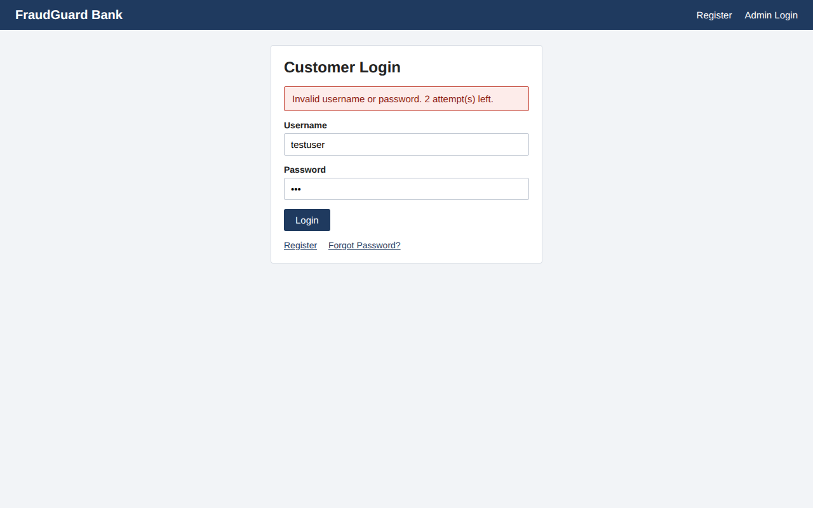
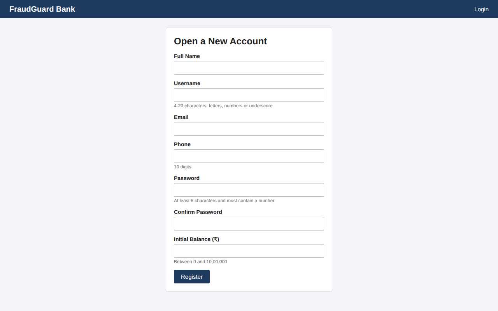
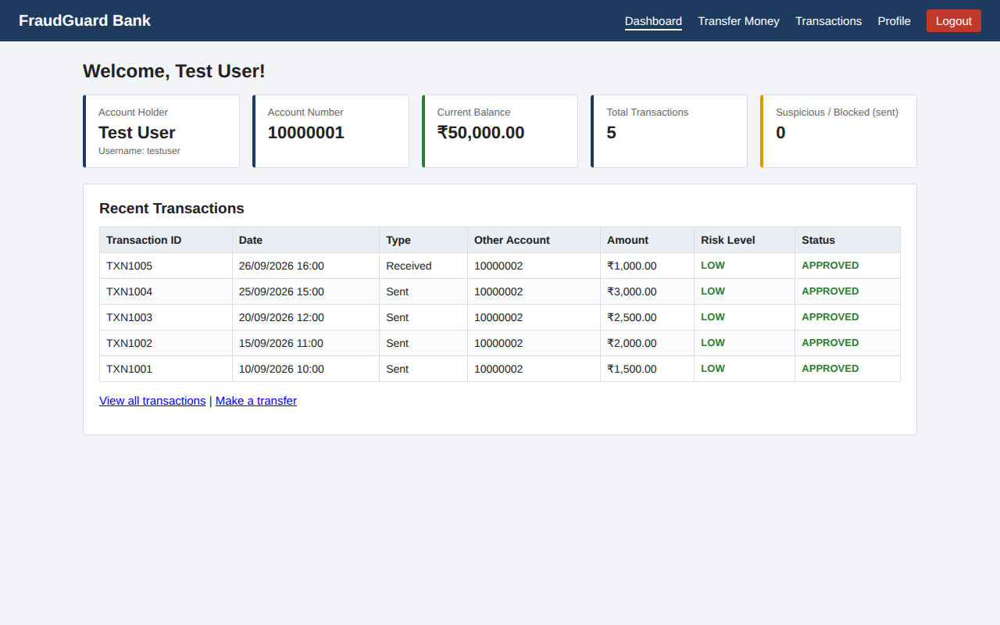
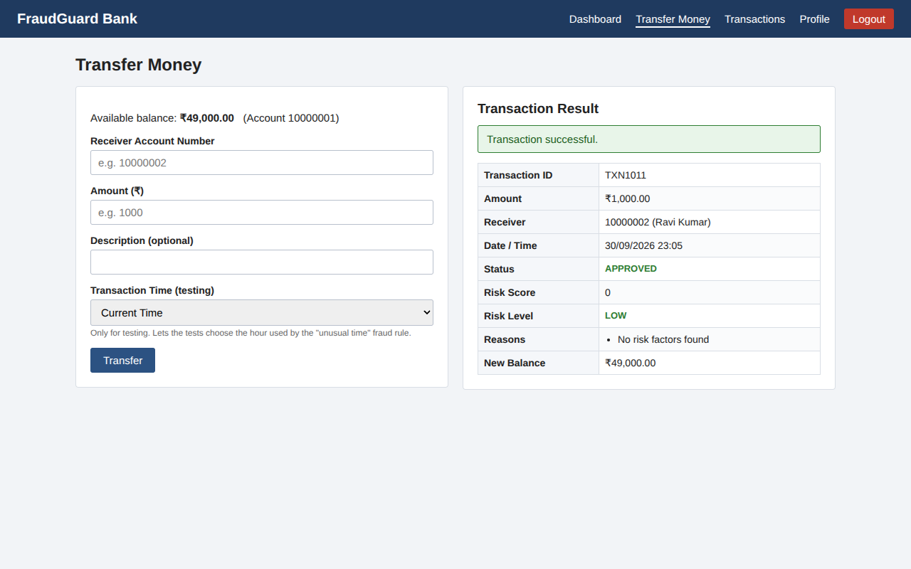
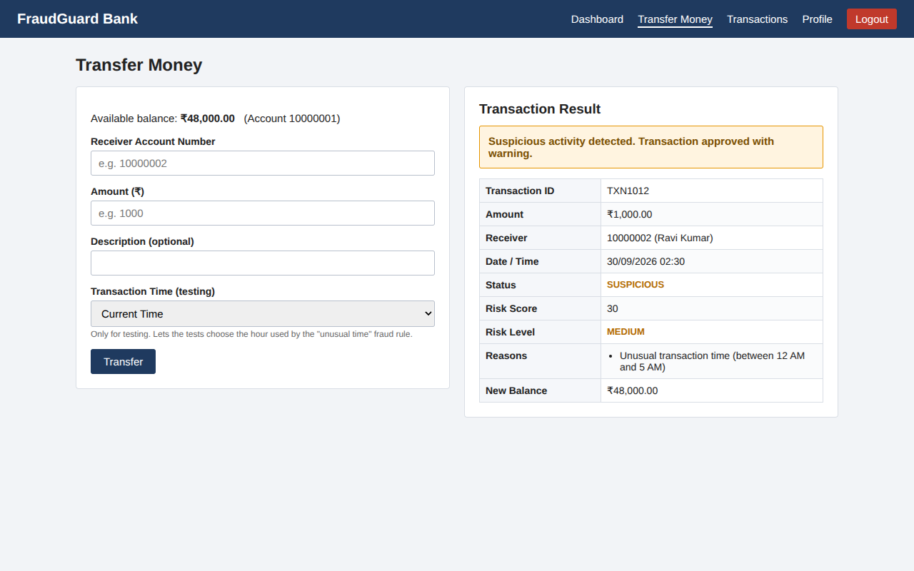
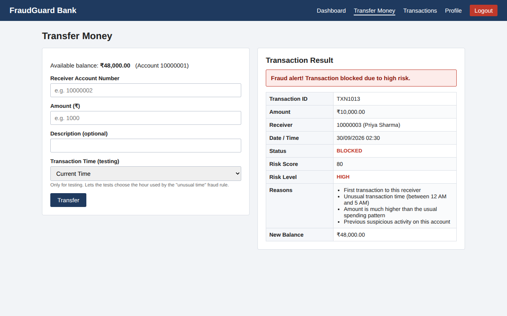
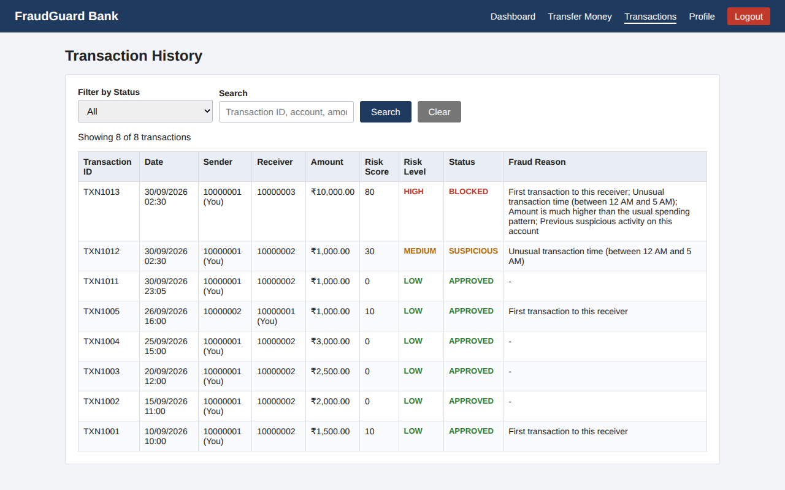
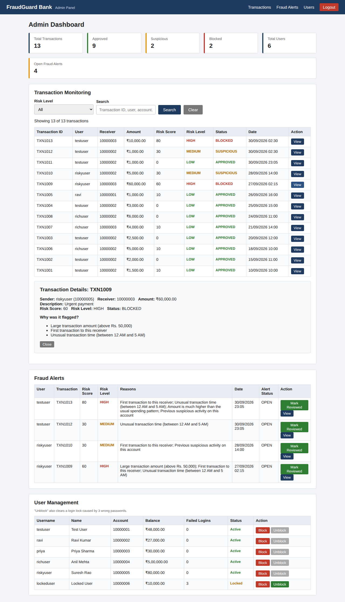

# AI-Based Banking Fraud Detection & Automated Testing Using Selenium

A simulated online banking web application with an **explainable, rule-based fraud detection
engine**, with a **Selenium IDE** project containing 7 suites and 30 selected test cases.

> College Software Testing Project · Node.js + Express + MongoDB + HTML/CSS/JS · Selenium IDE

---

## Table of Contents

1. [Project Title](#1-project-title)
2. [Abstract](#2-abstract)
3. [Problem Statement](#3-problem-statement)
4. [Objectives](#4-objectives)
5. [Features](#5-features)
6. [System Architecture](#6-system-architecture)
7. [Technology Stack](#7-technology-stack)
8. [Database Design](#8-database-design)
9. [Fraud Detection Methodology](#9-fraud-detection-methodology)
10. [Testing Methodology](#10-testing-methodology)
11. [Selenium IDE Setup](#11-selenium-ide-setup)
12. [How to Run the Project](#12-how-to-run-the-project)
13. [Test Credentials](#13-test-credentials)
14. [Test Cases](#14-test-cases)
15. [Expected Results](#15-expected-results)
16. [Screenshots](#16-screenshots)
17. [Limitations](#17-limitations)
18. [Future Enhancements](#18-future-enhancements)
19. [Conclusion](#19-conclusion)
- [Folder Structure](#folder-structure) · [API Reference](#api-reference) · [Troubleshooting](#troubleshooting)

---

## 1. Project Title

**AI-Based Banking Fraud Detection & Automated Testing Using Selenium**
(web application name: *FraudGuard Bank*)

## 2. Abstract

Online banking fraud causes large financial losses, and the software that detects it must be
reliable. This project builds a small online banking system in which every money transfer is
analysed by a fraud risk engine before it is completed. The engine checks six risk indicators
(amount, frequency, new receiver, time of day, deviation from normal spending and previous
suspicious activity), adds up a **risk score from 0 to 100**, and decides whether to approve,
approve with a warning, or block the transaction. Every decision comes with human-readable
reasons, so the result is *explainable*.

The main focus is **software testing**. The application was designed to be testable: stable
HTML IDs, deterministic results, a data-reset page and a simulated transaction time. A complete
Selenium IDE project with 30 selected automated functional test cases in 7 suites covers registration,
login, dashboard, money transfer, fraud detection, transaction history and the admin module.
The fraud engine is also covered by 10 unit tests.

## 3. Problem Statement

Banks must detect fraudulent transactions in real time, but:

- fraud checks that behave like a "black box" are hard to trust and hard to test;
- manual testing of banking workflows is slow, repetitive and error-prone;
- results that depend on the current time or on random values cannot be tested reliably.

The problem is to build a banking application with an explainable fraud detection module and
to verify its behaviour through **repeatable automated tests**.

## 4. Objectives

1. Develop a working online banking simulation (register, login, balance, transfer, history, logout).
2. Implement a deterministic, explainable fraud risk scoring engine.
3. Block high-risk transactions and create fraud alerts for the administrator.
4. Provide an admin dashboard for monitoring transactions, alerts and users.
5. Design the application for testability (stable IDs, reset data, simulated time).
6. Create a complete Selenium IDE test suite covering positive and negative scenarios.
7. Document test cases and test results in a standard format.

## 5. Features

**Customer**
- Registration with full validation (required fields, email, phone, password strength, confirmation, duplicate username, balance)
- Login with account lock after 3 failed attempts ("Account temporarily locked due to multiple failed login attempts.")
- Dashboard: welcome message, account number, balance, total and suspicious transaction counts, recent transactions, fraud warning
- Money transfer with validation and a confirmation showing ID, amount, receiver, date/time, status, risk score, risk level and reasons
- Transaction history with status filter (All / Approved / Suspicious / Blocked) and search
- Profile page, Forgot Password demo page, Logout

**Fraud detection**
- 6 explainable rules, risk score 0-100, LOW / MEDIUM / HIGH levels
- LOW → approved, MEDIUM → approved with warning + alert, HIGH → blocked + alert
- "Custom Test Time" option so the time rule can be tested at any hour

**Admin**
- Separate admin login
- Statistics: total, approved, suspicious, blocked transactions, total users, open alerts
- Transaction monitoring table with risk filter, search and "View details" (reasons)
- Fraud alerts table with "Mark Reviewed"
- User management: Block / Unblock (Unblock also clears a login lock)

**Testing support**
- `reset.html` reloads identical demo data before every test (TEST_MODE only)
- Selenium IDE `.side` project, test data file, test case document and test report

## 6. System Architecture

```text
 ┌─────────────────────────────┐        ┌────────────────────────────────────┐
 │  Browser                    │        │  Selenium IDE (browser extension / │
 │  HTML + CSS + JavaScript    │◄───────┤  app) plays banking-fraud-testing  │
 │  login, dashboard, transfer │ drives │  .side against localhost:3000      │
 │  transactions, admin ...    │        └────────────────────────────────────┘
 └──────────────┬──────────────┘
                │  fetch() JSON  /api/...   (session cookie)
 ┌──────────────▼───────────────────────────────────────────────────────────┐
 │  Node.js + Express server (backend/server.js)  - port 3000               │
 │   ├─ serves the frontend folder as static files                          │
 │   ├─ routes/      auth · user · transactions · admin · test              │
 │   ├─ middleware/  requireLogin · requireAdmin                            │
 │   ├─ controllers/ business logic                                         │
 │   └─ services/    validators.js · fraudEngine.js ◄── same rules as ──┐   │
 └──────────────┬───────────────────────────────────────────────────────┼───┘
                │ Mongoose                                              │
 ┌──────────────▼──────────────┐                     ┌──────────────────┴───┐
 │  MongoDB  banking_fraud_db  │                     │ fraud-detection/     │
 │  users · transactions ·     │                     │ fraud_engine.py      │
 │  fraudalerts                │                     │ (standalone Python)  │
 └─────────────────────────────┘                     └──────────────────────┘
```

**Transfer flow:** validate input → check receiver and balance → collect sender history
(last 5 minutes, earlier receivers, average amount, earlier flags) → fraud engine →
save transaction → move money only if not BLOCKED → create fraud alert if MEDIUM/HIGH →
return result to the page.

One server serves both the API and the pages, so there is only one thing to start and no CORS setup.

## 7. Technology Stack

| Layer | Technology |
|---|---|
| Frontend | HTML5, CSS3, plain JavaScript (fetch API) |
| Backend | Node.js 18+, Express 4, express-session, bcryptjs |
| Database | MongoDB (via Mongoose 8) |
| Fraud engine | Rule-based engine in Node.js (`backend/services/fraudEngine.js`); identical Python version in `fraud-detection/fraud_engine.py` |
| Functional testing | Selenium IDE (`.side` project) |
| Unit testing | Node.js built-in test runner (`npm test`) |

No paid APIs, no real banking APIs, no internet connection needed at runtime.

## 8. Database Design

Database: `banking_fraud_db`

**users**

| Field | Type | Notes |
|---|---|---|
| _id | ObjectId | |
| name | String | required |
| username | String | required, unique, lowercase |
| email | String | required |
| phone | String | 10 digits |
| password | String | bcrypt hash (plain password is never stored) |
| accountNumber | String | unique, 8 digits (10000001 ...) |
| balance | Number | ≥ 0 |
| failedLoginAttempts | Number | reset after successful login |
| isLocked | Boolean | true after 3 wrong passwords |
| isBlocked | Boolean | set by the admin |
| role | String | `user` or `admin` |
| createdAt | Date | |

**transactions**

| Field | Type | Notes |
|---|---|---|
| _id | ObjectId | |
| transactionId | String | unique, TXN1001, TXN1002 ... |
| senderAccount / receiverAccount | String | account numbers |
| amount | Number | > 0 |
| description | String | optional, max 100 chars |
| riskScore | Number | 0-100 |
| riskLevel | String | LOW / MEDIUM / HIGH |
| status | String | APPROVED / SUSPICIOUS / BLOCKED |
| fraudReasons | [String] | explanation of the score |
| transactionTime | Date | time used by the fraud engine (may be a simulated test time) |
| createdAt | Date | real save time (used by the frequency rule) |

**fraudalerts**

| Field | Type | Notes |
|---|---|---|
| _id | ObjectId | |
| transactionId | String | links to transactions.transactionId |
| userId | ObjectId | ref users |
| riskScore | Number | |
| riskLevel | String | MEDIUM / HIGH |
| reasons | [String] | |
| status | String | OPEN / REVIEWED |
| createdAt | Date | |

Relationships: a user sends many transactions (by `accountNumber`); a MEDIUM/HIGH transaction has one fraud alert.

## 9. Fraud Detection Methodology

The engine is an **explainable rule-based expert system**. Each rule that matches adds points
and a reason. The total is capped at 100.

| # | Rule | Condition | Points | Reason shown |
|---|---|---|---|---|
| 1a | Very large amount | amount > ₹1,00,000 | +40 | Very large transaction amount (above Rs. 1,00,000) |
| 1b | Large amount | amount > ₹50,000 (if 1a did not match) | +20 | Large transaction amount (above Rs. 50,000) |
| 2 | High frequency | 3 or more earlier transfers by the sender in the last 5 minutes | +30 | Multiple transactions within a short period (3 or more in last 5 minutes) |
| 3 | New receiver | sender never paid this receiver before | +10 | First transaction to this receiver |
| 4 | Unusual time | transaction hour between 00:00 and 04:59 | +30 | Unusual transaction time (between 12 AM and 5 AM) |
| 5 | Amount deviation | at least 3 earlier non-blocked transfers and amount > 3 × their average | +20 | Amount is much higher than the usual spending pattern |
| 6 | Previous suspicious activity | sender has an earlier SUSPICIOUS or BLOCKED transfer | +20 | Previous suspicious activity on this account |

| Score | Level | Action |
|---|---|---|
| 0-29 | LOW | Approve |
| 30-59 | MEDIUM | Approve with warning, create fraud alert |
| 60-100 | HIGH | Block (no money moves), create fraud alert |

*Why these weights?* The example weights in the brief (+30 large amount, +25 frequency, +15 night)
were tuned so that each of the required demo scenarios lands in the required level: a strong
single indicator (rapid transfers or night-time) reaches MEDIUM, and a very large transfer that is
also far above the user's normal amount reaches HIGH.

**Worked example (Scenario E):** testuser (average ₹2,250) sends ₹10,000 to a new receiver at 02:30
→ unusual time 30 + new receiver 10 + deviation 20 = **60 → HIGH → BLOCKED**.

**Determinism:** there is no randomness. For testing, the transfer page offers a *Custom Test Time*
(HH:MM) when the server runs with `TEST_MODE=true`; the frequency rule uses the real save time.

The Python file gives the same results (checked on 300 random inputs):
```bash
python fraud-detection/fraud_engine.py          # prints scenarios A-E
echo {"amount": 150000, "hour": 10, "past_amounts": [5000,4000,6000]} | python fraud-detection/fraud_engine.py --json
```

## 10. Testing Methodology

| Level | Tool | What is tested |
|---|---|---|
| Unit testing | `node --test` | Fraud engine rules, level boundaries (29/30, 59/60), 05:00 boundary, cap at 100, determinism |
| Functional / system testing | Selenium IDE | 30 selected end-to-end cases through the real UI, API and database |
| Regression testing | Selenium IDE "Run all" | The whole suite can be re-run after every change |

Techniques used:
- **Equivalence partitioning** - valid / empty / non-numeric / negative / zero amounts
- **Boundary value analysis** - balance limit (₹60,000 > ₹50,000), risk level edges, 3rd failed login
- **Positive and negative testing** - valid inputs vs every validation message
- **State-based testing** - Active → Locked → Unblocked; alert OPEN → REVIEWED
- **Data-driven variables** - `store`, `storeText`, `executeScript` values reused in later steps

Principles that make the suite reliable:
1. **Independent tests** - each test starts with *Helper - Reset Demo Data*.
2. **Deterministic data** - the seed data is always the same, so the first new transaction is always `TXN1011`.
3. **No real-clock dependency** - transfers use *Custom Test Time*.
4. **Stable locators** - every important element has a fixed `id`.
5. **Explicit waits** - result boxes are hidden until the server answers; tests use `waitForElementVisible`.
6. **Reusable steps** - login/transfer are helper tests called with `run`.

## 11. Selenium IDE Setup

1. Install **Selenium IDE** from https://www.selenium.dev/selenium-ide/ (browser extension for
   Chrome/Firefox, or the desktop app - both open `.side` files).
2. Start the project (section 12) and check that http://localhost:3000 opens.
3. Open Selenium IDE → **Open an existing project** → choose `selenium/banking-fraud-testing.side`.
4. The project base URL is `http://localhost:3000`. Change it at the top of the IDE if you use another port.
5. Select a suite from the **Test suites** drop-down and click **Run all tests in suite**, or
   click **Run all** to run all 7 suites.

Notes
- The `run` command (used by helper tests) needs a recent Selenium IDE version (3.17 or newer).
- The suite **"Helpers (called by other tests)"** does not need to be run by itself.
- If your computer is slow, move the IDE speed slider one step towards "slow".
- Optional command-line run: `npm install -g selenium-side-runner` then
  `selenium-side-runner selenium/banking-fraud-testing.side` (needs Chrome + chromedriver).
- `selenium/build-side.js` is the readable source of the `.side` file. After editing it run
  `node selenium/build-side.js` to regenerate the file (optional).
- The included Selenium project has a 700 ms demo delay after each browser action. In PowerShell,
  adjust it and regenerate the project with `$env:DEMO_PAUSE_MS='1200'; node selenium/build-side.js`.
  Set it to `0` for normal speed. Reopen the `.side` file in Selenium IDE after regenerating.

## 12. How to Run the Project

### Prerequisites
- **Node.js 18 or newer** - https://nodejs.org (check: `node -v`)
- **MongoDB Community Server 6/7** - https://www.mongodb.com/try/download/community
  (on Windows install it "as a Service" so it starts automatically), **or** Docker:
  `docker run -d --name mongo -p 27017:27017 mongo:7`
- Python 3.8+ (only for the optional `fraud_engine.py` demo)

### Step 1 - Install
```bash
cd AI-Banking-Fraud-Detection/backend
npm install
```

### Step 2 - Configure
```bash
# Windows (cmd)
copy .env.example .env
# Linux / macOS
cp .env.example .env
```
Default values work with a local MongoDB (`mongodb://127.0.0.1:27017/banking_fraud_db`).

### Step 3 - MongoDB
Make sure MongoDB is running (Windows: Services → "MongoDB Server" → Running; or the Docker
command above). The database and collections are created automatically.

### Step 4 - Seed the database
```bash
npm run seed
```
Prints `[SEED] Done: { users: 7, transactions: 10, alerts: 2 }` and the login list.

### Step 5 - Start the backend (this also serves the frontend)
```bash
npm start
```
You should see `[SERVER] Running at http://localhost:3000`.

### Step 6 - Open the frontend
Open **http://localhost:3000** in the browser. There is no separate frontend server - Express
serves the `frontend` folder. (Do not open the HTML files by double-clicking; they need the server.)

### Step 7 - Run the tests
- Unit tests: `npm test` (inside `backend`) → fraud engine regression tests
- Browser end-to-end tests: start MongoDB and the app in test mode, then run `npm run test:e2e` (inside `backend`). This runs the Selenium IDE project in headless Chrome; it requires Chrome/Chromium and a working ChromeDriver.
- Continuous integration: GitHub Actions runs the unit tests and the Selenium browser suite for pushes, pull requests, and manual runs (`.github/workflows/ci.yml`). The workflow starts MongoDB, seeds a dedicated CI database, then starts the app with `TEST_MODE=true`.

For local browser tests, keep the server running in one terminal:
```bash
# Terminal 1, from backend (MongoDB must be running)
npm run seed
set TEST_MODE=true
npm start

# Terminal 2, from backend
npm run test:e2e
```
On PowerShell use `$env:TEST_MODE='true'` instead of `set TEST_MODE=true`. Selenium Side Runner is fetched by `npx` on its first run.
- Selenium: see section 11

## 13. Test Credentials

| Role | Username | Password | Account | Balance | Purpose |
|---|---|---|---|---|---|
| Admin | admin | Admin@123 | - | - | Admin dashboard (use **Admin Login**) |
| User | testuser | Test@123 | 10000001 | ₹50,000 | Main test user |
| User | ravi | Ravi@123 | 10000002 | ₹25,000 | Known receiver of testuser |
| User | priya | Priya@123 | 10000003 | ₹30,000 | New receiver for testuser |
| User | richuser | Rich@123 | 10000004 | ₹5,00,000 | Large-transfer scenario |
| User | riskyuser | Risky@123 | 10000005 | ₹80,000 | Already has flagged transfers |
| User | lockeduser | Locked@123 | 10000006 | ₹10,000 | Starts locked |

Test receiver account: **10000002**. All data is fake. Full list: `selenium/test-data/test-data.json`.
To restore everything, open http://localhost:3000/reset.html or run `npm run seed`.

## 14. Test Cases

| Suite | Test cases |
|---|---|
| 1 Registration | TC-REG-001, 004, 005, 007 |
| 2 Login | TC-LOG-001, 003, 006, 007 |
| 3 Dashboard | TC-DB-001, 004, 006 |
| 4 Money Transfer | TC-TR-001, 003, 007, 009 |
| 5 Fraud Detection | TC-FD-001 to TC-FD-006 |
| 6 Transaction History | TC-TH-001, 006, 008 |
| 7 Admin | TC-AD-001, 002, 004, 006, 007, 008 |
| **Total** | **30** |

Full steps, data and expected results: [`documentation/test-cases.md`](documentation/test-cases.md).
Previous execution results for the original 56-case suite: [`documentation/test-report.md`](documentation/test-report.md).

## 15. Expected Results

**Fraud scenarios (with fresh demo data):**

| Scenario | Input | Score | Level | Status |
|---|---|---|---|---|
| A Normal | testuser → 10000002, ₹1,000, 10:00 | 0 | LOW | APPROVED |
| B Large | richuser → 10000002, ₹1,50,000, 10:00 | 60 | HIGH | BLOCKED |
| C Rapid | testuser → 10000002, ₹500 four times | 30 (4th) | MEDIUM | SUSPICIOUS |
| D Night | testuser → 10000002, ₹1,000, 02:30 | 30 | MEDIUM | SUSPICIOUS |
| E Multiple | testuser → 10000003, ₹10,000, 02:30 | 60 | HIGH | BLOCKED |

**Admin dashboard after reset:** Total 10 · Approved 8 · Suspicious 1 · Blocked 1 · Users 6 · Open alerts 2.

**Selenium:** the project contains 30 selected cases in 7 suites. Unit tests: 10.

## 16. Screenshots

Real screenshots of the running application are in `documentation/screenshots/`.
Add your own Selenium IDE screenshots in the placeholders below.

| Screen | File |
|---|---|
| Login with error message |  |
| Registration |  |
| User dashboard |  |
| Transfer - LOW / approved |  |
| Transfer - MEDIUM / suspicious |  |
| Transfer - HIGH / blocked |  |
| Transaction history |  |
| Admin dashboard |  |
| Selenium IDE - project opened | *(add screenshot: `documentation/screenshots/selenium-ide-project.png`)* |
| Selenium IDE - all suites passed | *(add screenshot: `documentation/screenshots/selenium-ide-results.png`)* |
| MongoDB Compass - collections | *(add screenshot: `documentation/screenshots/mongodb-collections.png`)* |

## 17. Limitations

- Fraud detection is rule-based with fixed weights; it does not learn from data.
- Sessions are stored in server memory (log in again after a server restart).
- Transfers update two documents without a MongoDB transaction (a crash in between could leave balances inconsistent).
- No OTP / two-factor verification for MEDIUM-risk transfers; Forgot Password is a demo page.
- Test-mode features (`/reset.html`, custom time) must be disabled (`TEST_MODE=false`) outside testing.
- Single-currency, single-account-per-user, local deployment only.

## 18. Future Enhancements

- Train a machine-learning model (e.g. logistic regression / isolation forest) on transaction
  history and combine its probability with the explainable rules.
- OTP / email verification for MEDIUM-risk transfers.
- MongoDB transactions (replica set) for atomic transfers; persistent session store.
- Selenium WebDriver (Java/Python) + TestNG/PyTest for data-driven tests and CI (GitHub Actions).
- Performance testing with JMeter, security testing with OWASP ZAP.
- Email/SMS notifications for fraud alerts, charts on the admin dashboard.

## 19. Conclusion

The project delivers a working banking simulation whose fraud decisions are deterministic and
explained in plain language, and shows how designing for testability (stable IDs, resettable
data, simulated time) makes complete automation possible. The Selenium IDE project covers all
major modules with 30 selected, repeatable test cases, supported by unit tests of the fraud
engine, demonstrating a full software-testing life cycle from test design to execution and reporting.

---

## Folder Structure

```text
AI-Banking-Fraud-Detection/
├── README.md
├── frontend/
│   ├── index.html  login.html  register.html  forgot-password.html
│   ├── dashboard.html  transfer.html  transactions.html  profile.html
│   ├── admin-login.html  admin.html
│   ├── reset.html                  (test tool: reload demo data)
│   ├── css/style.css
│   └── js/ common.js login.js register.js dashboard.js transfer.js
│           transactions.js admin-login.js admin.js
├── backend/
│   ├── server.js  package.json  .env.example
│   ├── config/db.js
│   ├── models/ User.js Transaction.js FraudAlert.js
│   ├── routes/ authRoutes.js userRoutes.js transactionRoutes.js adminRoutes.js testRoutes.js
│   ├── controllers/ authController.js userController.js transactionController.js adminController.js
│   ├── services/ fraudEngine.js validators.js
│   ├── middleware/auth.js
│   ├── seed/ seed.js seedData.js
│   └── tests/fraudEngine.test.js
├── fraud-detection/fraud_engine.py
├── selenium/
│   ├── banking-fraud-testing.side  (import this into Selenium IDE)
│   ├── build-side.js               (readable source of the .side file)
│   └── test-data/test-data.json
└── documentation/
    ├── test-cases.md  test-report.md
    └── screenshots/
```

## API Reference

| Method | URL | Auth | Purpose |
|---|---|---|---|
| POST | /api/auth/register | - | Create account |
| POST | /api/auth/login | - | Customer login |
| POST | /api/auth/admin-login | - | Admin login |
| POST | /api/auth/logout | - | Logout |
| GET | /api/auth/me | session | Current user |
| GET | /api/user/dashboard | user | Dashboard data |
| GET | /api/user/profile | user | Profile |
| POST | /api/transactions/transfer | user | Transfer + fraud check |
| GET | /api/transactions | user | My transactions |
| GET | /api/admin/stats · /transactions · /alerts · /users | admin | Admin data |
| POST | /api/admin/users/:username/block · /unblock | admin | Block / unblock |
| POST | /api/admin/alerts/:transactionId/review | admin | Mark alert reviewed |
| GET | /api/test/status | TEST_MODE | Is test mode on? |
| POST | /api/test/reset | TEST_MODE | Reload demo data |

## Troubleshooting

| Problem | Solution |
|---|---|
| `[DB] Could not connect to MongoDB` | Start MongoDB (Windows Services → MongoDB Server, or `docker start mongo`). Check `MONGO_URI` in `backend/.env`. Use `127.0.0.1` instead of `localhost`. |
| `EADDRINUSE: port 3000` | Another program uses port 3000. Change `PORT` in `.env` **and** the base URL in Selenium IDE. |
| Page shows "Cannot reach the server" | The backend is not running, or you opened the HTML file directly. Use http://localhost:3000. |
| reset.html says "Test mode is disabled." | Set `TEST_MODE=true` in `backend/.env` and restart. |
| "Transaction Time (testing)" is missing on the transfer page | Same as above - it only appears in test mode. |
| Selenium tests fail with wrong balances / IDs | Every test resets data itself. Make sure nobody else uses the app while the suite runs, and that you are using the provided `.side` file. |
| Selenium: "run" command unknown | Update Selenium IDE to the latest version. |
| Selenium tests time out on a slow PC | Move the IDE speed slider to a slower setting, or increase the `10000` wait values. |
| Can't login after 3 wrong passwords | Login as admin → Users → **Unblock**, or open `/reset.html`. |
| `npm install` fails | Use Node.js 18+ (`node -v`), delete `node_modules` and retry. |
